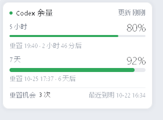
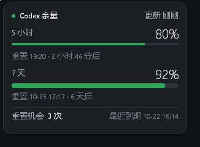
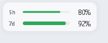

# QuotaPin

Codex 剩余额度显示小工具：常驻托盘，一个图标 + 一个面板，显示 **5 小时额度**、**7 天额度**、**两者的重置时间**和**重置机会**。

程序体积 <500 KB，无需安装双击即用，常态内存占用 < 10 MB。

<p align="center">
  
  
</p>

---

## 开始使用

1. **双击 `QuotaPin.exe`** —— 托盘出现沙漏图标，常驻后台。建议右键开启“开机启动功能”。
2. **左键单击图标** —— 弹出上面的面板；点面板外任意位置收起。
3. **右键单击图标** —— 立即刷新 / 小窗常驻 / 开机自启 / 退出。

`QuotaPin.exe` 会维护一份状态文件在 `%APPDATA%\QuotaPin\`，用于记录少量配置和状态信息。

## 面板提供的信息
整体状态，更新时间，5 小时窗口和 7 天窗口的余量百分比、进度条、重置时间与倒计时。  

累计重置机会次数和最近一次的到期时间。  

点任意一行可以在「剩余 / 已用」之间切换，方便对照别处的用量数字。

## 小窗

Codex 或 ChatGPT 窗口在前台时，桌面右下角会浮出一张小卡片显示`5h` / `7d` 两条进度条：

<p align="center"></p>

按住左键可拖动，位置会记住；单击它弹出完整面板。支持右键菜单里勾选「小窗常驻」。

## 通知

有时会主动在 Windows 通知中心发出通知。通过右键菜单勾选“静默运行”可以关闭通知能力。

| 时机 | 通知 |
| --- | --- |
| 余量跌破 80 / 60 / 40 / 20 / 0% | 每个节点各一次，5 小时与 7 天各自计算 |
| 额度重置（窗口翻篇或用掉重置机会） | 「额度已重置」，附新周期信息 |
| 重置机会到期前 3 天内 | 当天 10:00 提醒一次，每个机会只提醒一次 |

首次启动只记录当前状态、不补发历史通知；同一个节点不会重复提醒。

## 数据来源

读取本机 Codex 已经登录的凭证（`%USERPROFILE%\.codex\auth.json`），直接请求 Codex 客户端自己用的两个接口，只取余量、重置时间、重置机会这三类字段。拉取频率：Codex 在运行时 3 分钟一次，没运行时 30 分钟一次。

**不上报任何数据，不修改凭证，不落任何缓存**。

## 常见问题

**托盘里没有图标？** Windows 11 默认把新图标收进「^」溢出区，拖到任务栏上即可（此时点击也正常）。

**提示「找不到 Codex 凭证」？** 需要先用 ChatGPT 账号登录过 Codex 桌面端或 CLI。只配了 API key 的账号拿不到这套额度数据。

**提示「HTTP 401」？** 登录过期了，打开 Codex 重新登录一次，QuotaPin 数秒后会自动恢复，不用重启。

**数字变灰了？** 最近一次请求失败，面板底部会写出原因。

## 开发者

设计取舍、数据流、通知状态机、UI 度量与渲染管线见 **[DEVDOC.md](DEVDOC.md)**；快速上手：

```powershell
cargo build --release      # target/release/QuotaPin.exe
cargo test --release       # 逻辑测试
```

## 许可

MIT
